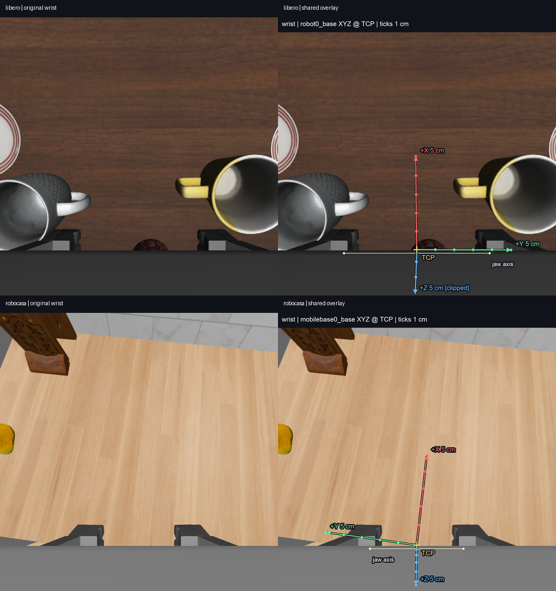

# Minimal Robot Harness

一个最小的机器人多模态闭环：**观察 → Kimi/其他 policy → 校验动作 → 执行 → 再观察**。
保留通用腕部 TCP overlay，把任务 reset、控制器与原生成功判定留给 benchmark adapter。

本仓库是从已完成的 Kimi LIBERO / RoboCasa 实验中提取的视觉层，加上一份精简闭环。
它不是旧批量实验逐行为复刻，也尚未包含独立可运行的 LIBERO/RoboCasa 物理执行器。

```text
Benchmark.observe() ── RGB + K/T + measured TCP ──┐
                                              ↓
                                 wrist overlay + model history
                                              ↓
                                    injected Kimi/policy client
                                              ↓
                         JSON / observation_id / action validation
                                              ↓
Benchmark.execute() ── measured feedback ── native success ── repeat
```

## 文件

| 文件 | 职责 |
| --- | --- |
| `harness.py` | 单 episode 闭环、两张实时图、历史、动作校验入口和事件记录 |
| `tcp_overlay.py` | 通用投影/绘图；可单文件使用，无仿真引擎依赖 |
| `tcp_overlay_adapter.py` | 已有 LIBERO/RoboCasa session 与历史 metadata 的桥接 |
| `examples/` | 两个 benchmark 的真实历史腕部图、标定 JSON、overlay，以及离线闭环示例 |
| `tests/` | 历史投影回归、边界条件、动作执行与成功判定测试 |
| `docs/harness.md` | 原实验配方、动作协议和接入边界 |

## 快速运行（离线，不请求模型）

需要 Python 3.10+。

```bash
python -m venv .venv
source .venv/bin/activate
python -m pip install -e '.[dev]'
python tcp_overlay.py examples/libero_snapshot.json outputs/libero_overlay.png
python tcp_overlay.py examples/robocasa_snapshot.json outputs/robocasa_overlay.png
python examples/dry_run.py --output outputs/dry-run-001
python -m pytest -q
```

`dry_run.py` 使用 fake robot/fake policy，只验证接线。它不代表真实任务成功率。
每次闭环运行使用全新的输出目录；异常时不会自动恢复并重复物理动作。

## Overlay 语义

- 黄色 TCP：实测末端位置，不是上次请求的目标位置。
- 红 X / 绿 Y / 蓝 Z：**参考坐标系轴平移到 TCP 处**，不是 tool-local 旋转轴。
  默认每轴 5 cm，刻度 1 cm。
- 白线：两个 finger-pad 中心的连线，可省略；不表示物体轴、接触或抓取成功。
- 不依赖深度图、不做遮挡测试、不读取物体真值。



跨 benchmark 只需要给出同一时刻的图像、内参 K、相机到参考系的外参、实测 TCP，
以及可选的两指位置。输入单位为米；图片尺寸、裁剪和镜像必须已经体现在 K 中。
支持带符号的焦距：历史 LIBERO 使用负 fx，RoboCasa 非镜像图片使用正 fx。
移动基座每轮必须刷新外参和 TCP。畸变图先 rectify；不要在 renderer 再翻图。

## 接入真实 policy 和 benchmark

```python
from harness import run

# benchmark: observe(), validate_action(), execute(), success()
# policy(messages): 返回完整 chat-completions 风格的 response dict
result = run(
    benchmark, policy,
    instruction=task_instruction,
    action_prompt=benchmark_action_schema,
    output_dir="outputs/episode-001",
)
```

`policy` 可以包装现有 Kimi client：

```python
def policy(messages):
    return kimi_client.chat(messages, max_tokens=65536, timeout=1200)
```

本仓库没有硬编码 endpoint、API key、模型名称或 thinking 档位；这些由 client 显式配置。
不需要复制任何旧实验的凭据文件。Client 必须处理超时并返回完整响应，流式半截 JSON
不能执行；收到 `finish_reason != "stop"` 会拒绝动作。网络重试只允许重试生成。

Adapter 的 `validate_action` 在物理执行前检查完整 schema、坐标系、单位、步数与
workspace 限制；必须无副作用。`execute` 不自动重试。`success` 必须来自原生
benchmark；模型 `finish` 仅结束对话，不会被计为成功。

当前最小闭环默认 120 calls / 40 actions / 最近 8 组实时图。它没有批量调度、demo 注入、
原实验的像素上限、wall-time/tick/memory guards 或生产 API 重试。这些应按用途显式增加，
不能把本仓库的精简 dry-run 当作原实验等价复现。

## 来源与验证

Overlay 来自 PhysLM 的 LIBERO 两图实验（2026-11-02）及 RoboCasa mobile v3
（2026-10-30），于 2026-11-03 抽取。真实样例仅含机器人观测和标定；未包含完整数据集、
模型输出、权重或凭据。来源说明见 [docs/provenance.md](docs/provenance.md)。

测试用两个原始 renderer 产生的投影作为期望值，覆盖 TCP、jaw、XYZ、正负 fx、
移动参考系、矩形图像、近平面与出界裁剪。不宣称在新的 benchmark 上验证过控制闭环。
图片样式有所调整，投影几何有回归测试；旧实验代码保持冻结。
