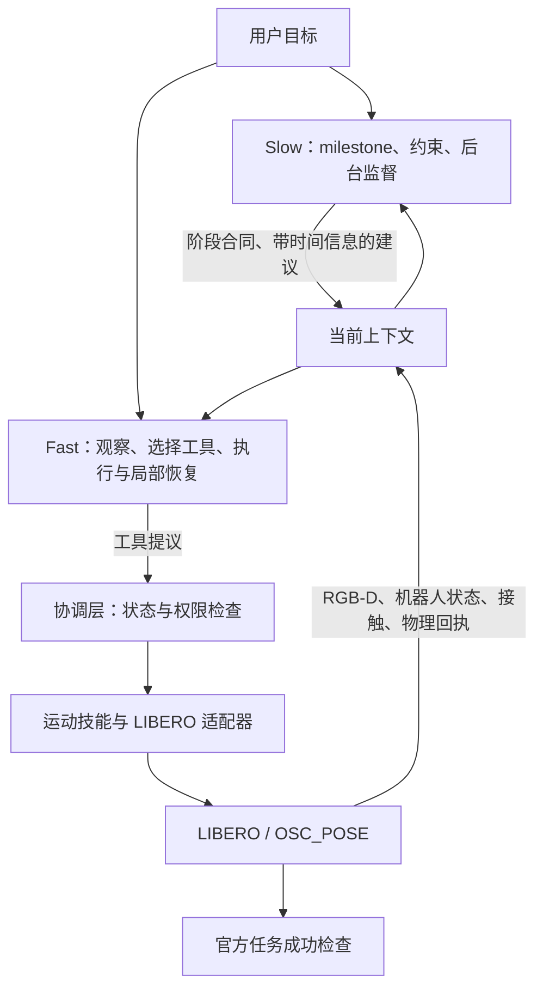

# R27 系统设计

## 两个模型角色

Slow 不获得执行工具目录。它决定阶段目标、约束和需要满足的条件，并在后台查看新证据。Fast 获得完整任务、当前阶段合同、当前场景和工具回执，自主选择测点、抓取方向、落点及恢复方式。

三种对照模式复用相同工具与物理环境：`single_fast` 由 Fast 模型独立执行，`single_strong` 由 Slow 对应的强模型独立执行，`dual_async` 才使用双角色协作。纯 Slow 模式中的执行模型与双角色系统里的无工具 Slow 是两种职责。

## Milestone 与异步执行

- 初始规划可以与一次只读场景准备并行；阶段合同尚未形成时不提前执行依赖合同的物理动作。
- 执行中后台 Slow 读取进展，给出建议、暂停或重规划请求。普通高层建议保留来源、时间和动作信息，不因 Fast 完成一个新动作就自动删除；Fast 对照当前证据判断是否采纳。
- 阶段完成进入 checkpoint：Slow 判断阶段目标和剩余任务。审核可以与只读准备重叠，但依赖下一阶段合同的运动仍需等待。
- 协调层处理当前动作、暂停、合同版本和工具前置条件。语义判断主要由模型完成；通过门禁不意味着动作正确或任务成功。

这仍是有串行部分的系统：初始规划、阶段审核以及必要重规划可能让 Fast 等待。R27 没有独立抓取前目标 judge，也没有额外强模型恢复执行器。

## 上下文与记忆

| 信息 | 组织方式 |
| --- | --- |
| 当前状态 | 最新观测、机器人与接触状态、当前阶段、近期真实动作回执 |
| 短期事件 | Fast 最近 6 条、Slow 最近 12 条相关事件投影 |
| 对话历史 | 各模型客户端保留最多 6 条历史消息，约 3 轮问答 |
| 战略建议 | 当前任务内保留带时间和来源信息的高层建议，由 Fast 判断相关性 |
| 图像 | 固定任务初始图、当前观测图，以及最多两张匹配的历史外观参考 |
| 跨任务经验 | 按任务中的目标短语检索四张固定参考图，不包含当前位置或当前身份认证 |
| 审计材料 | SQLite 事件、图像和模型记录保存在运行目录，便于复核 |

这一版没有模型驱动的语义压缩、历史图像自主换入换出或专门的 KV cache 管理。持久高层建议也不能让旧坐标变成当前可执行证据。

## 候选、测点与动作

RGB-D 几何生成版本化候选，例如 `p138o-c3`。它表示某次观察中的可见表面组件，不是永久物体 ID，也不包含目标语义。Fast 根据图像选择候选或像素，工具返回 `point_id`、三维位置及相应观察来源，再用于抓取或放置。

候选选择、测点和抓取/放置/拉动等路径会检查各自的当前观察关联。但通用 `move_to` 对普通测点的逐帧检查并不完全相同，直接提供裸坐标也可能丢失来源关联；因此不能宣称所有旧坐标都被统一阻断。这是后续可以单独完善的边界。

R27 的具体改进是抓取方向合同：接近方向 `approach_world` 和夹爪闭合方向 `jaw_world` 分别描述；显式输入需要成对、有限且能构成有效姿态。错误在运动前拒绝，并以带来源的历史诊断保留，防止一次只读观察将错误说明冲掉。系统不会替模型自动猜测正确姿态。

运动技能运行于模拟器的 OSC_POSE 控制器，有动作幅度和时限边界。模拟接触不等于实机避障或路径安全证明；参考实现仅用于仿真。
